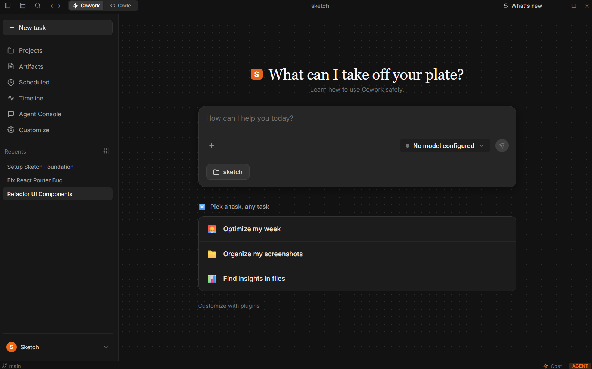
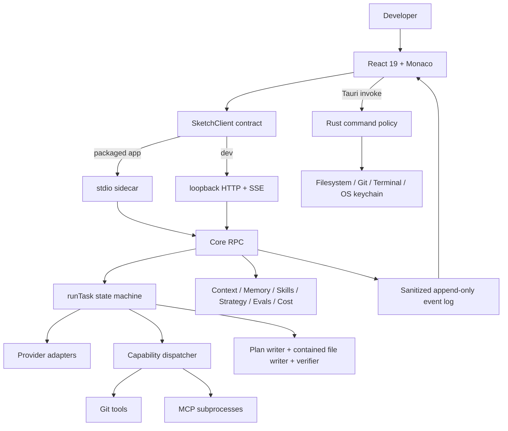
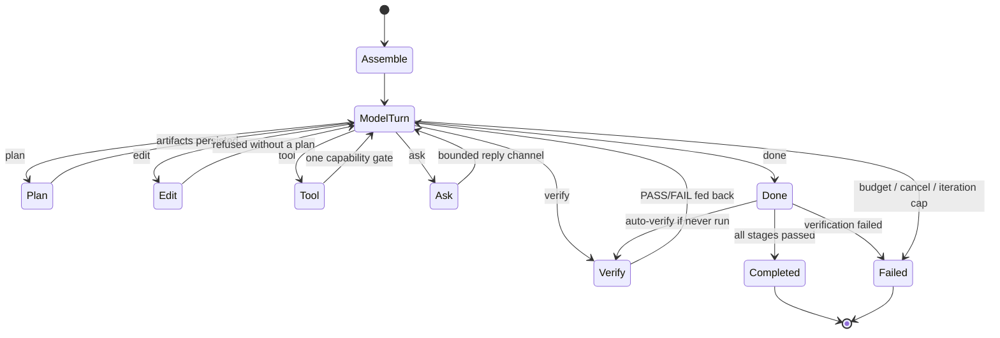
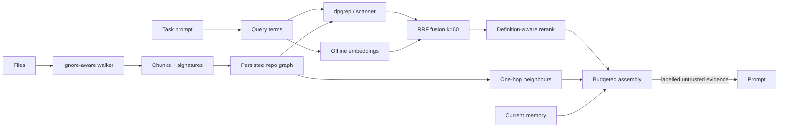
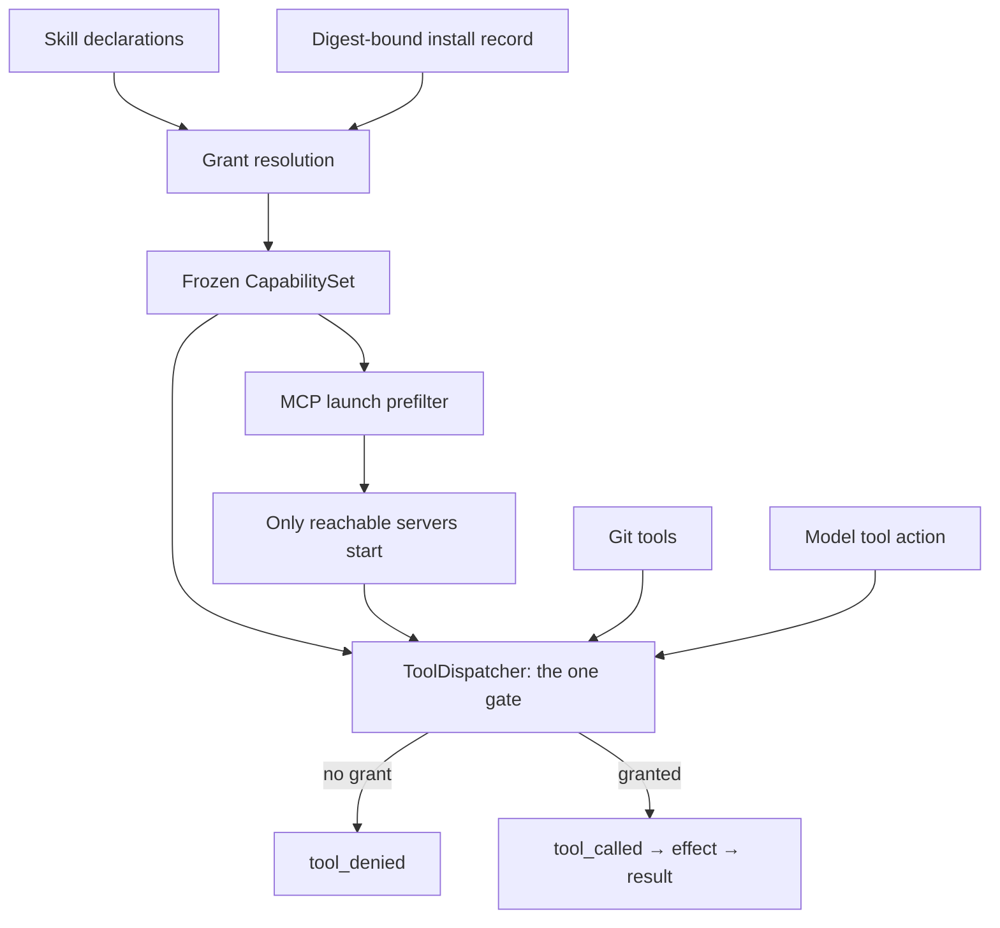

<div align="center">


# Sketch

**A local-first AI engineering environment — one desktop window over one dependency-free engine.**

Your code stays on your disk. Your keys stay in the OS credential store. The only thing that leaves
your machine is the model call you configured.

[](https://github.com/sarang-sketch/sketch/actions/workflows/ci.yml)
[](https://github.com/sarang-sketch/sketch/actions/workflows/package.yml)
[](LICENSE)
[](https://nodejs.org)
[](packages/core/package.json)
[](#verify-it-yourself)

[Features](#features) · [Screenshots](#the-two-surfaces) · [Architecture](#architecture) ·
[Install](#install) · [Contributing](#contributing) · [Why this can compete](#why-sketch-has-a-real-shot-at-the-top)

</div>

---

## What Sketch is

Sketch is an **AI engineering OS**, not a chat box bolted onto an editor. Every run is an
append-only, replayable event stream. The agent must write a plan before it may edit a file. Every
tool call passes exactly one capability gate. Every command runs without a shell. Every claim of
"done" is checked against a real verification contract.

Two surfaces, one engine:

- **Cowork** — an agent-first task workspace for delegated work.
- **Code** — a full IDE with Monaco, explorer, search, git, terminal, diff review, and an agent sidebar.

**Status: pre-v1, and honest about it.** The engine, the code surface, retrieval, memory, cost
control, capability-scoped tools, provider settings, and OS credential storage are real and tested.
The gaps are listed plainly in [What is real and what is not](#what-is-real-and-what-is-not) — not
hidden in a footnote.

---

## The two surfaces

### 1. Cowork — the agent surface

The agent-first workspace. Delegate a task, watch it work, review artifacts, replay the timeline.

<div align="center">
  
</div>

```
┌───────────────────────────────────────────────────────────────────────────────┐
│  [◫] [⊞] [🔍] [‹ ›]   ✦ Cowork  |  <> Code            Sketch      $ What's new │
├──────────────────────┬────────────────────────────────────────────────────────┤
│  + New task          │                                                        │
│                      │        [S]  What can I take off your plate?            │
│  ▢ Projects          │           Learn how to use Cowork safely.              │
│  ▤ Artifacts         │  ┌──────────────────────────────────────────────────┐  │
│  ◷ Scheduled         │  │  How can I help you today?                       │  │
│  ∿ Timeline          │  │  +                    ● No model configured  ➤   │  │
│  ▭ Agent Console     │  └──────────────────────────────────────────────────┘  │
│  ⚙ Customize         │     ▢ Work in a project or folder                      │
│                      │                                                        │
│  Recents             │  ▤ Pick a task, any task                               │
│  Setup Foundation    │   ┌────────────────────────────────────────────────┐   │
│  Fix Router Bug      │   │ ▦ Optimize my week                             │   │
│  Refactor UI         │   │ ▢ Organize my screenshots                      │   │
│                      │   │ ▥ Find insights in files                       │   │
│  [S] Sketch      ⌄   │   └────────────────────────────────────────────────┘   │
└──────────────────────┴────────────────────────────────────────────────────────┘
                                                          ✦ Cost      AGENT
```

### 2. Code — the IDE surface

The full engineering surface. AI Team shows which of the 13 roles this project can actually verify,
and says so when it cannot.

<div align="center">
  
</div>

```
┌────────────────────────────────────────────────────────────────────────────────────┐
│ [S] ✦Cowork <>Code   File Edit Selection View Go Run Terminal   Sketch IDE   ─ □ × │
├────┬──────────────────────────┬──────────────────────────────┬────────────────────┤
│ ▢  │ AI TEAM                  │                              │ Agent      + ⟳ …  ×│
│ 🔍 │ 5 of 13 roles verifiable │           [ S ]              │                    │
│ ⑃  │ Default strategy: single │        Sketch IDE            │  $ Sketch          │
│ ⑂  │                          │                              │                    │
│ ◈  │ STRATEGIES               │  ┌────────────────────────┐  │                    │
│ ∿  │ ┌──────────────────────┐ │  │  ▢ Open Folder         │  │                    │
│ ▭  │ │ single    [DEFAULT]  │ │  └────────────────────────┘  │                    │
│ ▷  │ │ One agent, one run.  │ │  ┌────────────────────────┐  │                    │
│ ✓  │ ├──────────────────────┤ │  │  ⬡ Clone Repository    │  │                    │
│ ⚡ │ │ plan-then-code       │ │  └────────────────────────┘  │  ┌──────────────┐  │
│ ◷  │ │ Planner writes the   │ │                              │  │ Ask anything │  │
│ ▤  │ │ plan, then one impl. │ ├──────────────────────────────┤  │ @ mention    │  │
│ ⚇  │ ├──────────────────────┤ │ Terminal  +   allowlisted,   │  │ ● No model ⌄ │  │
│ ⑃  │ │ swarm  — off by      │ │           no shell — not a   │  └──────────────┘  │
│    │ │ default until        │ │           sandbox         ×  │                    │
│    │ │ measured pass@k lift │ │ No folder is open, so there  │ AI may make        │
│    │ └──────────────────────┘ │ is no project to run a       │ mistakes. Double   │
│    │ ROLES                    │ command in.                  │ check generated    │
│    │ ✓ VERIFIABLE  CEO        │ $ Open a folder to run       │ code.              │
└────┴──────────────────────────┴──────────────────────────────┴────────────────────┘
                                              TSX  Ln 42, Col 15  UTF-8  ✦ Cost  IDE
```

> **Note on the images:** the two `docs/assets/*.png` files are the real product screenshots. If you
> are viewing a fork that did not fetch them, the ASCII layouts above describe the same surfaces
> exactly.

---

## Features

### The agent loop — seven actions, one gate, one terminal event

`runTask` is a bounded state machine, not a pile of callbacks. Seven actions: `plan`, `think`,
`edit`, `verify`, `tool`, `ask`, `done`.

- **Plan-before-edit is enforced in the engine**, by asking the filesystem — not an in-memory flag.
  An `edit` with no persisted plan is refused and fed back.
- **Every action is emitted before it executes**, so a process that dies mid-call still leaves proof
  of the attempt.
- **`done` is only success** when every configured verification stage passed. If the model claims
  completion without verifying, verification runs anyway.
- **Exactly one terminal event** per run: `run_completed` or `run_failed`.
- Bounded iterations, cancellation by run id, and an opt-in interactive reply channel for `ask`.

### Verification contract — nine ordered stages, no shell

```
format → lint → typecheck → build → unit → integration → security → performance → dependency-audit
```

`verify.yaml` wins when present; otherwise stages are detected per stack. Commands are spawned with
`shell: false` and an argument **vector**, so metacharacters in a filename or a model-authored
argument are data, never syntax. Unconfigured stages report `skipped`; stages after a failure report
`not-run`. Those are not interchangeable. A source-level guard forbids `shell: true` anywhere in the
engine.

### Capability-scoped tools and MCP

One authorization point, and a test asserts it stays the only one.

- Capabilities are an explicit vocabulary (`fs:read:project`, `git:write`, `net:http`, …) that
  **fails closed** on anything unrecognized.
- A grant is resolved per run from installed-skill records bound to a content digest, then frozen.
- A server the grant cannot reach is **never started** — not merely refused. A process that never
  launched cannot read a token or open a socket.
- MCP is hand-rolled JSON-RPC 2.0 over stdio. No SDK dependency. A hanging server latches
  unavailable and is killed; the run continues.
- **Tool output is framed as data**, and the system prompt states that a tool result asking the model
  to ignore its rules is a string a tool returned.

### Context engine — hybrid retrieval, never vector-only

Vector-only search is the most common reason an AI tool "cannot find" a symbol sitting right there.

- **Lexical channel** via ripgrep, with a bounded scanner fallback that scores identically and
  reports that it degraded.
- **Vector channel** with offline-first embeddings that degrade instead of failing.
- **Reciprocal-rank fusion** (k=60) plus a definition-aware rerank.
- **Term coverage is the first sort key** — matching three of a question's terms beats repeating one
  term twelve times.
- One-hop dependency expansion from a persisted repository graph, assembled under a **token budget
  enforced before the text is built**, preferring signatures over bodies when truncating.

### Versioned project memory

Every entry carries `valid_from` / `valid_to`. Newer facts **supersede** rather than overwrite, with
a recorded reason and a `memory_superseded` event, so history stays queryable. Retrieval fuses text
and metadata channels with a bounded recency prior, excludes retracted entries, and rides inside the
same context budget. Run ingestion is deliberately narrow: only the verification outcome and the
plan the run actually committed.

### Cost control

Usage comes from `llm_response` events, so the dashboard equals the log by construction — one
function, not two sources. Budgets are checked **before every call**, because a budget checked
afterward has already been exceeded. On breach: deterministic stop or downgrade. A content-addressed
response cache turns a repeated identical request into a `cache_hit` with no second call.

### Strategies, evals, and honest benchmarks

`single` is the default. `plan-then-code` and role-based `swarm` exist behind a dispatcher with
deterministic merge — a conflict creates a follow-up task and never guesses. **`swarm` ships off**,
because no measured pass@k lift justified enabling it. Benchmarks are framed as lift
(`model + Sketch` vs the same `model + naive`) and never claim to beat a model. The committed CI
result is explicitly labeled synthetic.

### The desktop surface

Monaco with **one authoritative file cache** (the editor model is a projection, and exactly two
functions cross that boundary). Per-hunk diff review where rejecting every hunk leaves the file
byte-identical. Real git panel with correct porcelain parsing for renames, quoted paths, detached
HEAD, and no upstream. Real explorer, search, terminal, cost dashboard, memory panel, MCP status,
skills, benchmarks, and a live architecture view with seven generated diagrams.

### Privacy that is a test, not a promise

No telemetry. No analytics. No crash reporting. No account. No Sketch server. No update check. No
CDN — the fonts are vendored into the bundle. Event payloads are redacted on the **write** path, so a
key cannot reach the log even if a call site forgets. See [PRIVACY.md](PRIVACY.md), which names every
outbound path in the source.

---

## Codebase at a glance

Measured on this repository, first-party source only — `dist/`, `target/`, `node_modules/`, and
generated bundles excluded.

| Metric | Count |
|---|---:|
| First-party source + test files | **370** |
| Source files (`src/`, `scripts/`, CI) | **302** |
| **Lines of source code** | **64,418** |
| Test files | **121** |
| Lines of test code | **37,368** |
| Core engine tests passing | **1,087** (59 files) |
| Desktop tests passing | **523** (55 files) |
| Rust policy + credential tests | **32** |
| Runtime dependencies in `@sketch/core` | **0** |

Roughly **0.58 lines of test for every line of source**, and the tests are mostly invariant gates
rather than snapshots.

### Languages and stack

| Layer | Technology |
|---|---|
| Engine | TypeScript, NodeNext, zero runtime dependencies, stdio JSON-line CLI |
| Desktop UI | React 19, TypeScript, Monaco, CSS Modules, Vite 6 |
| Native host | Rust, Tauri 2 (filesystem/git/terminal policy, OS credential store) |
| Transports | stdio sidecar (production), loopback HTTP + SSE (development) |
| Persistence | Append-only JSONL events, JSON repository graph, versioned memory |
| Tests | Vitest (core + desktop), standalone `rustc --test` for native policy |
| CI/CD | GitHub Actions: build, typecheck, dual-provider test matrix, bench gate, native packaging |

---

## Architecture

### System



### The run loop



### Retrieval



### Permissions



Full detail, including the state directory layout and every seam, is in
[architecture.md](architecture.md).

---

## Install

### Requirements

- **Node 20+** (Node 22 in CI)
- **Rust stable** — only for the native Tauri build, not for the engine or the tests
- **ripgrep** *(optional)* — fast lexical retrieval; a bounded scanner takes over when absent

### Clone and verify — offline, no key, $0

```bash
git clone https://github.com/sarang-sketch/sketch.git
cd sketch
npm install
npm run build        # FIRST: the desktop typecheck consumes core's emitted .d.ts
npm run typecheck
npm test
```

> **Build before typecheck.** On a cold tree, `packages/core/dist` does not exist yet and the desktop
> typecheck reports ~43 phantom errors that have nothing to do with your code.

Run the suites per workspace — several guard tests read source relative to the process cwd:

```bash
npm test -w @sketch/core
npm test -w @sketch/desktop
```

### Run the desktop app

```bash
npm run dev:desktop     # Vite dev server; the engine runs over a loopback bridge
```

For the native app (Tauri 2):

```bash
npm run build:sidecar -w @sketch/desktop
npm run verify:sidecar -w @sketch/desktop
npm run package:windows -w @sketch/desktop   # or package:macos / package:linux on that host
```

Native filesystem, terminal, and OS credential features are Tauri commands. In a plain browser they
fail loudly by design rather than pretending to work — use the packaged app or `npm run tauri dev`
for those.

### Drive the engine directly

The engine is a stdio JSON-line CLI. One JSON object per line in, one per line out.

```bash
SKETCH_FAKE_PROVIDER=1 node packages/core/dist/cli.js
{"id":1,"method":"ping","params":{}}
{"id":2,"method":"run","params":{"task":{"id":"t1","prompt":"say hello","verify":[]}}}
```

### Use a real model for free — local, on your hardware

```bash
ollama pull llama3.2
```

Then configure it in **Provider Settings**, or write `~/.sketch/providers.json`:

```json
{
  "version": 1,
  "selected": "ollama",
  "providers": [
    { "id": "ollama", "kind": "openai-compatible",
      "baseUrl": "http://localhost:11434/v1", "model": "llama3.2", "label": "Ollama (local)" }
  ]
}
```

No key, no account, nothing leaves the machine. **This file never holds a key** — a field whitelist
and a byte-level scan of the serialized JSON both enforce it. LM Studio (`:1234/v1`) and
`llama.cpp` work through the same adapter. Free hosted tiers (Google AI Studio, GitHub Models, Groq,
Cloudflare Workers AI, OpenRouter) and paid providers (OpenAI, Anthropic, Azure) use the same
catalog. Keys go to the OS credential store, never to a file.

### The cost ladder

1. **`FakeChatAdapter`** — tests and CI. Free, offline, deterministic.
2. **Local model** via Ollama / LM Studio / llama.cpp. Free, offline, private.
3. **A free hosted tier** — when local inference is too slow.
4. **A paid provider** — only if you choose to.

There is no paid-only path anywhere in this project.

---

## Verify it yourself

The claims above are checkable. These are the guards that make them so:

| Claim | Test |
|---|---|
| `@sketch/core` has zero runtime dependencies | `packages/core/test/deps.test.ts` |
| The core suite cannot reach a non-loopback host | `packages/core/test/no-egress.test.ts` |
| `providers.json` holds no key material | `packages/core/test/providerSettings.test.ts` |
| No telemetry vocabulary in any source file, manifest, or the lockfile | `packages/core/test/privacy.test.ts` |
| A provider error never carries your key | `packages/core/test/privacy.test.ts` |
| A key never reaches the event log on disk | `packages/core/test/store.test.ts` |
| Nothing the window loads comes from off this machine | `packages/desktop/src/privacy.egress.test.ts` |
| `run_command` is an allowlist, not a shell | `packages/desktop/src/lib/security.test.ts` |
| One containment implementation, symlinks included | `packages/desktop/src-tauri/src/command_policy.rs` |
| The capability gate is the only authorization point | `packages/core/test/capabilities.test.ts` |
| A hanging tool cannot hang a run | `packages/core/test/phase7-gate.test.ts` |
| An overrun stops deterministically and the dashboard equals the log | `packages/core/test/phase8-gate.test.ts` |
| A contradicting decision supersedes the older one | `packages/core/test/phase9-gate.test.ts` |

Native policy tests, where `cargo test` cannot link:

```bash
cd packages/desktop/src-tauri
rustc --edition=2021 --test src/command_policy.rs -o policy && ./policy
rustc --edition=2021 --test src/secret_store.rs   -o secret && ./secret
```

---

## What is real and what is not

**Real, and tested.** The dependency-free engine. The append-only redacted event log every surface
projects from. The seven-action loop with the plan gate enforced in the engine. The shell-less
verify runner and nine-stage contract. Capability-scoped tools, git tools, and the MCP host.
Hybrid retrieval with a persisted repository graph. Versioned memory with supersession, injected
into live runs. Cost accounting, pre-call budgets, routing, and a response cache. Strategy
dispatch with deterministic merge. The eval harness and capture-a-run-as-an-eval. Monaco with one
file cache, per-hunk diff review, real git/explorer/search/terminal panels. Provider settings with
a key-free config file. OS credential storage in Rust. Cancellation and an interactive reply
channel.

**Seam, gated, or absent — no pretending.**

- **Nothing here has ever run against a real hosted provider.** Every executed test used the fake
  adapter, synthetic responses, or a labeled loopback stub. This line stays until someone does it
  with a key and writes down what happened.
- The committed benchmark result is **synthetic offline CI evidence**, not a claim about any model.
- `swarm` is **off**: no measured pass@k lift.
- **Ghost completions are inert in production** — the seam exists, only tests supply a provider.
  Wiring one without per-keystroke spend accounting would put unbounded model calls behind a
  keystroke.
- The **debugger is an entry point**, not a debugger.
- Native installers are **unsigned** (no Authenticode, no Developer ID) and no tagged release has
  been published.
- Clean-machine offline proof is **not yet retained** — see [OFFLINE-PROOF.md](OFFLINE-PROOF.md).
- The terminal allowlist bounds **which program starts, not what it does**. `node`, `python`,
  `npm`, `cargo`, and `git` all execute arbitrary code by design. The real boundaries are the
  confirmation gate, the contained working directory, and the absence of a shell. **It is not a
  sandbox**, and the UI says so.

---

## Why Sketch has a real shot at the top

Most AI IDEs compete on how fast they can generate code. That race is won by whoever has the best
model, and it resets every few months. Sketch is built on the bet that the durable advantage is
**trust you can verify** — because as agents take on more autonomous work, the bottleneck stops
being generation and becomes *knowing whether to believe the result*.

Six things here are genuinely hard for a competitor to retrofit:

1. **Event sourcing is the foundation, not a log file.** Timeline, cost, evals, benchmarks, and
   audit are all projections of one sanitized append-only stream. Bolting this on later means
   rewriting every surface. It also means a run is *forensically reconstructable* — which is what
   regulated teams actually need and almost nobody ships.

2. **The gates live in the engine, and the tests are adversarial.** The plan gate asks the
   filesystem. There is exactly one capability check, one containment primitive, one verify path.
   Guards are mutation-verified: broken deliberately, watched to fail, restored. A test that has
   never failed has never been shown to test anything.

3. **Zero runtime dependencies in the engine.** No transitive package can phone home, and a
   no-egress tripwire wraps `fetch` and raw sockets across the whole core suite. In a market where
   supply-chain and tool-poisoning attacks are the live threat, "there is nothing to compromise" is
   a feature that cannot be added later.

4. **Honesty is enforced by CI.** A benchmark artifact whose provider is not a synthetic identity
   *fails the suite*, so the docs cannot silently go stale. `swarm` stays off because the
   measurement said so. Unproven claims are labeled in the README you are reading. This builds the
   one thing AI tooling is currently short of: credibility.

5. **Local-first is architectural, not a settings toggle.** No account, no server, no telemetry, no
   CDN, vendored fonts, keys in the OS keychain, and a first-class local-model path. For teams that
   cannot send source to a vendor, this is not a preference — it is the only option.

6. **The measurement substrate already exists.** Eval harness, capture-a-run-as-an-eval, pass@k with
   full distributions, fixed budgets, same-model lift framing, and a CI regression gate. Turning
   research into shipped improvement is a *loop*, and the loop is already built.

**Being straight about the gap:** Sketch does not beat Cursor, Claude Code, or Codex today. It lacks
their completion quality, polish, distribution, real-model evidence, and OS-level sandboxing. The
honest path to the top is narrow and specific — close the sandbox and authority gaps, publish real
same-model benchmarks, prove the clean-machine offline run, and ship semantic repository
intelligence. The foundation those things need is what already exists here, and that is the part
that usually takes years.

---

## Contributing

**Contributions are welcome, and the project is open for them.**

### Please read this first

> **Every pull request is reviewed personally by me — the maintainer.**
> There is no bot merge, no auto-approve, and no second reviewer to fall back on.
> **This means review will take time.** Sometimes days, sometimes longer when the change touches
> security, the event log, capabilities, or the native host.
>
> **A slow review is not disinterest.** This project's core value is that its guarantees are real,
> and the only way that stays true is if one person actually reads every line that changes them.
> Please be patient — your PR has not been forgotten.
>
> I will read the code, run it, break the guards you touched, and come back with specifics.

### How to contribute

1. **Open an issue first** for anything non-trivial. A design conversation before code saves
   everyone's time — especially for architecture, security, or new subsystems.
2. **Fork and branch.** Never work on `main`.
   ```bash
   git checkout -b feat/short-description
   ```
3. **Read the ground rules** in [CONTRIBUTING.md](CONTRIBUTING.md). The five non-negotiables are
   there, and each exists because something broke.
4. **Write the test first** where you can, and keep one task per commit.
5. **Verify before you open the PR:**
   ```bash
   npm run build        # first, always
   npm run typecheck
   npm test -w @sketch/core
   npm test -w @sketch/desktop
   ```
   Run the suite **twice** — once with `SKETCH_FAKE_PROVIDER=1`, once with it unset.
6. **Prove your guard works.** If you touched a gate, guard, or redaction: break it, paste the
   failing output, restore it, paste the passing output. Green output alone is not evidence.
7. **Open the PR** with what changed, why, what you tested, and what you could *not* verify.

### The five rules that are not style preferences

1. **`packages/core` has zero runtime dependencies.** Write the 80-line module instead.
2. **Never weaken a gate, guard, or redaction to make a test pass.** Deleting an assertion,
   loosening a matcher, adding `.skip`, or introducing an epsilon are the same act.
3. **No fixture data in a shipped panel.** An empty panel names *why* it is empty.
4. **Green output is not evidence.** Break it, watch it fail, restore it.
5. **Commit at every green point.** This project's worst incident — API keys reaching disk
   unredacted after a cancelled agent silently removed a `sanitizePayload` call — was invisible
   precisely because there was nothing to bisect.

### Especially welcome

- **Security**: sandboxing, path containment, MCP isolation, supply-chain hardening
- **Retrieval**: LSP/SCIP semantic indexing, benchmark corpora, large-monorepo scale
- **Real evidence**: same-model benchmark runs, clean-machine offline proof
- **Providers**: adapters, routing quality, current pricing
- **Platform**: macOS and Linux testing — most development here has been on Windows
- **Accessibility**: keyboard navigation, screen readers, contrast

### Terms

Contributions are accepted under **Apache-2.0**, the license in [LICENSE](LICENSE). By opening a
pull request you confirm you have the right to submit the code and agree to license it under those
terms. Say "seam" where it is a seam and "stub" where it is a stub — in code, commits, and PRs.

---

## Documentation

| Document | What it covers |
|---|---|
| [architecture.md](architecture.md) | Layers, seams, state directory, data flow, technology boundaries |
| [PRIVACY.md](PRIVACY.md) | Every outbound path in the source, and the tests that enforce it |
| [CONTRIBUTING.md](CONTRIBUTING.md) | Ground rules, verification ritual, environment quirks |
| [EXTENSIBILITY.md](EXTENSIBILITY.md) | What is a real extension contract and what is closed |
| [PACKAGING.md](PACKAGING.md) | Native matrix, size budget, retained artifact evidence |
| [RELEASES.md](RELEASES.md) | Release provenance, and what it is *not* |
| [OFFLINE-PROOF.md](OFFLINE-PROOF.md) | The clean-machine evidence still required |

## Repository layout

```
packages/core        the engine — zero runtime deps, NodeNext, stdio CLI, 1,087 tests
  src/loop           the seven-action agent state machine
  src/verify         shell-less runner + nine-stage policy
  src/context        walker, graph, hybrid search, embeddings, assembly
  src/memory         versioned store, hygiene, retrieval, ingestion
  src/capabilities   the one authorization point
  src/mcp            hand-rolled JSON-RPC over stdio
  src/providers      OpenAI / Anthropic / Gemini / compatible adapters
  src/strategy       single, plan-then-code, swarm, merge, pass@k
  src/rpc            the method table both transports speak
  registry/          curated, hash-pinned skills

packages/desktop     React 19 + Vite window, Tauri 2 shell, 523 tests
  src/panels         agent, git, explorer, search, terminal, cost, memory, MCP, skills
  src/editor         Monaco integration over one authoritative file cache
  src/lib            SketchClient contract, stdio + HTTP transports, factory
  src-tauri/         Rust host: command policy, containment, OS credentials
```

## License

**Apache-2.0** — see [LICENSE](LICENSE). Vendored fonts (Inter, JetBrains Mono) are under the SIL
Open Font License 1.1, with their license texts beside them in
`packages/desktop/src/assets/fonts/`.

<div align="center">

**Built local-first. Verified, not asserted.**

If Sketch is useful to you, a star helps — and an issue helps more.

</div>
