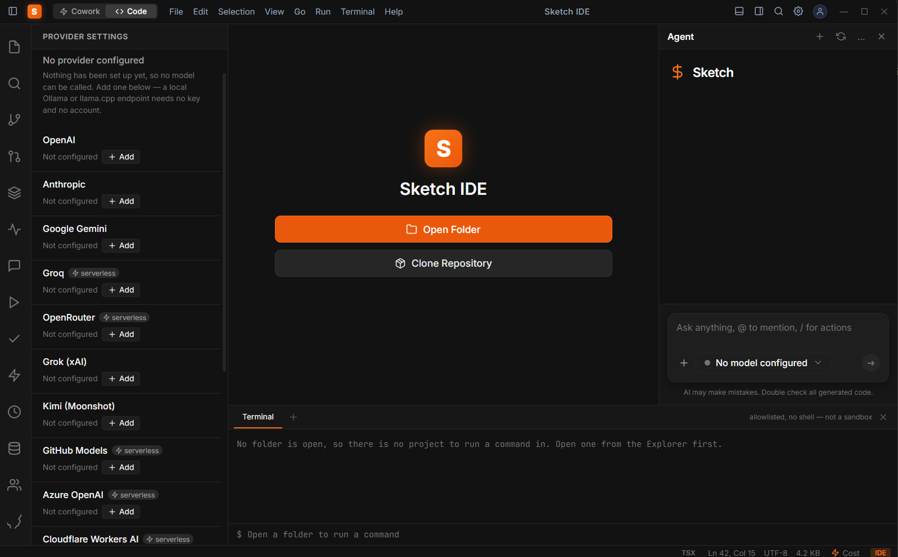
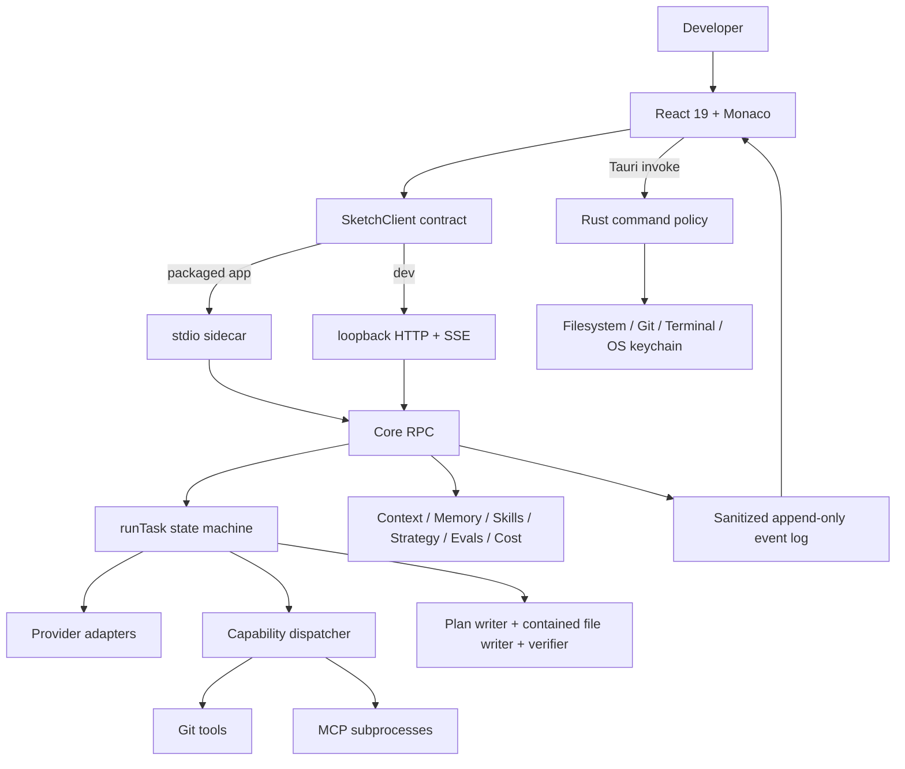
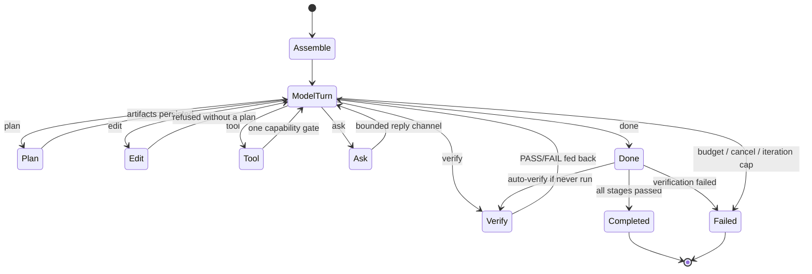
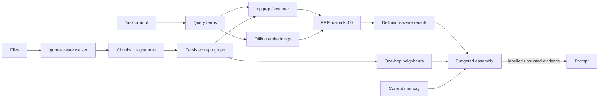
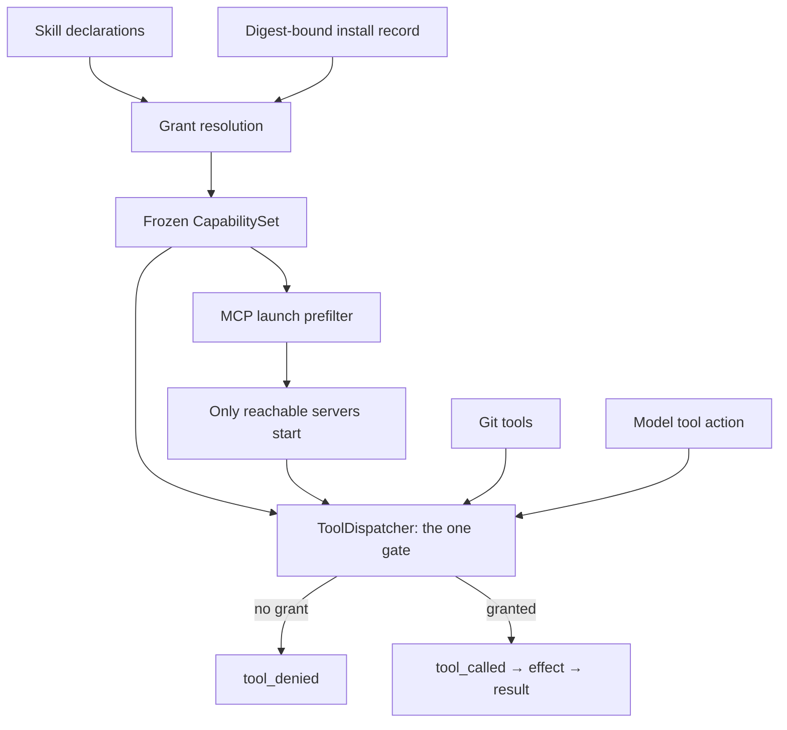

<div align="center">


# Sketch

**A local-first AI engineering environment — one desktop window over one dependency-free engine.**

Your code stays on your disk. Your keys stay in the OS credential store. The only thing that leaves
your machine is the model call you configured.

[](https://github.com/sarang-sketch/sketch/actions/workflows/ci.yml)
[](https://github.com/sarang-sketch/sketch/actions/workflows/package.yml)
[](LICENSE)
[](https://nodejs.org)
[](packages/core/package.json)
[](#verify-it-yourself)

[Features](#features) · [Screenshots](#the-two-surfaces) · [Architecture](#architecture) ·
[Install](#install) · [Contributing](#contributing) · [Why this can compete](#why-sketch-has-a-real-shot-at-the-top)

</div>

---

## What Sketch is

Sketch is an **AI engineering OS**, not a chat box bolted onto an editor. Every run is an
append-only, replayable event stream. The agent must write a plan before it may edit a file. Every
tool call passes exactly one capability gate. Every command runs without a shell. Every claim of
"done" is checked against a real verification contract.

Two surfaces, one engine:

- **Cowork** — an agent-first task workspace for delegated work.
- **Code** — a full IDE with Monaco, explorer, search, git, terminal, diff review, and an agent sidebar.

**Status: pre-v1, and honest about it.** The engine, the code surface, retrieval, memory, cost
control, capability-scoped tools, provider settings, and OS credential storage are real and tested.
The gaps are listed plainly in [What is real and what is not](#what-is-real-and-what-is-not) — not
hidden in a footnote.

---

## The two surfaces

### 1. Cowork — the agent surface

The task workspace brings projects, reusable workflows, conversations and tools together around
one composer. The charcoal-and-ember design follows the reference documented in [asta.md](asta.md).

<details>
<summary>Previous Cowork interface — screenshot from before the November redesign</summary>

<div align="center">
  
</div>

</details>

- **New task** opens a fresh draft. **Projects** opens real folders or clones repositories, and
  conversations stay available in the sidebar.
- **Workflows** offers ten editable starters and your own saved workflows. **Use workflow** prepares
  instructions for review; a model run starts only when you send the prompt.
- **Runs**, **Timeline** and **Console** show actual run records. **Skills**, **Tools & MCP** and
  **Memory** lead to the existing project tools.
- The composer reports **`No model configured`** when nothing is configured. It does not silently
  fall back to a default — an unconfigured run is refused, not faked.
- Your unsent draft and attached files follow you between Cowork and Code. Text drafts stay in
  this window's memory and are cleared by **New task / New chat**; they do not survive app restart.

<details>
<summary>Previous Cowork layout, retained with the earlier screenshot</summary>

```
┌───────────────────────────────────────────────────────────────────────────────┐
│  [◫] [⊞] [🔍] [‹ ›]   ✦ Cowork  |  <> Code            Sketch      $ What's new │
├──────────────────────┬────────────────────────────────────────────────────────┤
│  + New task          │                                                        │
│                      │        [S]  What can I take off your plate?            │
│  ▢ Projects          │           Learn how to use Cowork safely.              │
│  ▤ Artifacts         │  ┌──────────────────────────────────────────────────┐  │
│  ◷ Scheduled         │  │  How can I help you today?                       │  │
│  ∿ Timeline          │  │  +                    ● No model configured  ➤   │  │
│  ▭ Agent Console     │  └──────────────────────────────────────────────────┘  │
│  ⚙ Customize         │     ▢ Work in a project or folder                      │
│                      │                                                        │
│  Recents             │  ▤ Pick a task, any task                               │
│  Setup Foundation    │   ┌────────────────────────────────────────────────┐   │
│  Fix Router Bug      │   │ ▦ Optimize my week                             │   │
│  Refactor UI         │   │ ▢ Organize my screenshots                      │   │
│                      │   │ ▥ Find insights in files                       │   │
│  [S] Sketch      ⌄   │   └────────────────────────────────────────────────┘   │
└──────────────────────┴────────────────────────────────────────────────────────┘
                                                          ✦ Cost      AGENT
```

</details>

### 2. Code — the IDE surface

The editor and terminal form one working column beside a full-height agent. Move and resize the
panes, attach open files from **Agent → Context**, and open review tools without leaving your code.
Optional workbenches load on first use; switching surfaces preserves the editor and running session.

<details>
<summary>Previous Code interface — screenshot from before the November redesign</summary>

<div align="center">
  
</div>

Look closely at that AI Team panel, because it is the whole design philosophy in one screenshot:

- **"5 of 13 roles verifiable in this project"** — the panel refuses to pretend. A role with no
  distinct verification signal is reported as unverifiable instead of being shown as working.
- **`single` is `DEFAULT`**, and every measurement is compared against it.
- **`swarm` is off**, and the panel says exactly why: no pass@k lift has been measured in this
  project, so the cheaper default stands.
- The screenshot shows an earlier terminal, which ran an allowlist of programs with no shell. The
  terminal now runs your shell (see **The desktop surface** below) and still says plainly that it
  is not a sandbox.
- With no folder open, the terminal says so rather than presenting a fake prompt.

</details>

What the Code surface does on your desktop, in real time:

- **A real terminal.** Each tab is a real shell in a pseudo-terminal (ConPTY on Windows, a pty on
  macOS and Linux), rendered by xterm.js: arrow-key menus (`npm create vite@latest`), REPLs
  (`python`, `node`), `vim`, `git add -p`, colours, a virtualenv that stays active. The **⌄** next
  to **+** lists every shell Sketch found on the computer — PowerShell 7, Windows PowerShell,
  Command Prompt, Git Bash, each WSL distribution, MSYS2, Cygwin, Nushell; zsh, bash, fish on macOS
  and Linux. Ctrl+C copies a selection and interrupts otherwise; Ctrl+V pastes; file locations and
  URLs in the output are links; right-click → **Ask Sketch** sends the output to the agent.
- **The disk, live.** The engine watches the open folder: a file saved by another editor, a
  `git checkout` in an external terminal or a build writing files shows up in open tabs, the
  Explorer and Source Control within a moment. A tab with unsaved edits is never overwritten.
- **Your operating system.** Explorer → **Reveal in File Explorer / Finder** (Shift+Alt+R) and
  **Open in External Terminal** (Windows Terminal, Terminal.app, your Linux terminal).
- **Servers the agent can run.** With commands enabled, the agent can start a dev server in the
  background, read its output and stop it, instead of hanging on a command that never exits. Every
  background process stops when the run ends.
- **The window stays where you put it**: size, position and maximized state come back next launch.

<details>
<summary>Previous Code layout, retained with the earlier screenshot</summary>

```
┌────────────────────────────────────────────────────────────────────────────────────┐
│ [S] ✦Cowork <>Code   File Edit Selection View Go Run Terminal   Sketch IDE   ─ □ × │
├────┬──────────────────────────┬──────────────────────────────┬────────────────────┤
│ ▢  │ AI TEAM                  │                              │ Agent      + ⟳ …  ×│
│ 🔍 │ 5 of 13 roles verifiable │           [ S ]              │                    │
│ ⑃  │ Default strategy: single │        Sketch IDE            │  $ Sketch          │
│ ⑂  │                          │                              │                    │
│ ◈  │ STRATEGIES               │  ┌────────────────────────┐  │                    │
│ ∿  │ ┌──────────────────────┐ │  │  ▢ Open Folder         │  │                    │
│ ▭  │ │ single    [DEFAULT]  │ │  └────────────────────────┘  │                    │
│ ▷  │ │ One agent, one run.  │ │  ┌────────────────────────┐  │                    │
│ ✓  │ ├──────────────────────┤ │  │  ⬡ Clone Repository    │  │                    │
│ ⚡ │ │ plan-then-code       │ │  └────────────────────────┘  │  ┌──────────────┐  │
│ ◷  │ │ Planner writes the   │ │                              │  │ Ask anything │  │
│ ▤  │ │ plan, then one impl. │ ├──────────────────────────────┤  │ @ mention    │  │
│ ⚇  │ ├──────────────────────┤ │ Terminal  +   allowlisted,   │  │ ● No model ⌄ │  │
│ ⑃  │ │ swarm  — off by      │ │           no shell — not a   │  └──────────────┘  │
│    │ │ default until        │ │           sandbox         ×  │                    │
│    │ │ measured pass@k lift │ │ No folder is open, so there  │ AI may make        │
│    │ └──────────────────────┘ │ is no project to run a       │ mistakes. Double   │
│    │ ROLES                    │ command in.                  │ check generated    │
│    │ ✓ VERIFIABLE  CEO        │ $ Open a folder to run       │ code.              │
└────┴──────────────────────────┴──────────────────────────────┴────────────────────┘

```

</details>

### Make the workspace yours

Open **Customize layout** in the title bar for **Build**, **Review** and **Write** layouts, panel
visibility and focus mode. **Appearance & customization** opens the live settings preview:

- Choose dark, light or system appearance; graphite, midnight or warm stone surfaces; a preset or
  custom accent; compact or comfortable spacing; interface font and text size.
- Move the project sidebar and Code agent to either side. Place the activity bar on the side, at
  the top, or hide it. Resize panel dividers to suit your window.
- Adjust Cowork's conversation width and plain, dotted or grid background. Toggle the status bar,
  starter tips and reduced motion.

Preferences are saved on this device and included in **Settings → Export settings**. Built-in Monaco
and terminal colors follow the palette. Editor font and custom editor themes have separate settings.
Use **Ctrl+L** to focus the composer outside the editor or terminal, **Ctrl+K** for commands in Cowork
or inline edits in Code, and **Ctrl+Shift+L** to enter or leave focus mode.

Research sources, design decisions and the current verification record are in [asta.md](asta.md).
The screenshots above document the earlier interface; they are not screenshots of this redesign.

---

## Features

### The agent loop — seven actions, one gate, one terminal event

`runTask` is a bounded state machine, not a pile of callbacks. Seven actions: `plan`, `think`,
`edit`, `verify`, `tool`, `ask`, `done`.

- **Plan-before-edit is enforced in the engine**, by asking the filesystem — not an in-memory flag.
  An `edit` with no persisted plan is refused and fed back.
- **Every action is emitted before it executes**, so a process that dies mid-call still leaves proof
  of the attempt.
- **`done` is only success** when every configured verification stage passed. If the model claims
  completion without verifying, verification runs anyway.
- **Exactly one terminal event** per run: `run_completed` or `run_failed`.
- Bounded iterations, cancellation by run id, and an opt-in interactive reply channel for `ask`.

### Verification contract — nine ordered stages, no shell

```
format → lint → typecheck → build → unit → integration → security → performance → dependency-audit
```

`verify.yaml` wins when present; otherwise stages are detected per stack. Commands are spawned with
`shell: false` and an argument **vector**, so metacharacters in a filename or a model-authored
argument are data, never syntax. Unconfigured stages report `skipped`; stages after a failure report
`not-run`. Those are not interchangeable. A source-level guard forbids `shell: true` anywhere in the
engine.

### Capability-scoped tools and MCP

One authorization point, and a test asserts it stays the only one.

- Capabilities are an explicit vocabulary (`fs:read:project`, `git:write`, `net:http`, …) that
  **fails closed** on anything unrecognized.
- A grant is resolved per run from installed-skill records bound to a content digest, then frozen.
- A server the grant cannot reach is **never started** — not merely refused. A process that never
  launched cannot read a token or open a socket.
- MCP is hand-rolled JSON-RPC 2.0 over stdio. No SDK dependency. A hanging server latches
  unavailable and is killed; the run continues.
- **Tool output is framed as data**, and the system prompt states that a tool result asking the model
  to ignore its rules is a string a tool returned.

### Context engine — hybrid retrieval, never vector-only

Vector-only search is the most common reason an AI tool "cannot find" a symbol sitting right there.

- **Lexical channel** via ripgrep, with a bounded scanner fallback that scores identically and
  reports that it degraded.
- **Vector channel** with offline-first embeddings that degrade instead of failing.
- **Reciprocal-rank fusion** (k=60) plus a definition-aware rerank.
- **Term coverage is the first sort key** — matching three of a question's terms beats repeating one
  term twelve times.
- One-hop dependency expansion from a persisted repository graph, assembled under a **token budget
  enforced before the text is built**, preferring signatures over bodies when truncating.

### Versioned project memory

Every entry carries `valid_from` / `valid_to`. Newer facts **supersede** rather than overwrite, with
a recorded reason and a `memory_superseded` event, so history stays queryable. Retrieval fuses text
and metadata channels with a bounded recency prior, excludes retracted entries, and rides inside the
same context budget. Run ingestion is deliberately narrow: only the verification outcome and the
plan the run actually committed.

### Cost control

Usage comes from `llm_response` events, so the dashboard equals the log by construction — one
function, not two sources. Budgets are checked **before every call**, because a budget checked
afterward has already been exceeded. On breach: deterministic stop or downgrade. A content-addressed
response cache turns a repeated identical request into a `cache_hit` with no second call.

### Strategies, evals, and honest benchmarks

`single` is the default. `plan-then-code` and role-based `swarm` exist behind a dispatcher with
deterministic merge — a conflict creates a follow-up task and never guesses. **`swarm` ships off**,
because no measured pass@k lift justified enabling it. Benchmarks are framed as lift
(`model + Sketch` vs the same `model + naive`) and never claim to beat a model. The committed CI
result is explicitly labeled synthetic.

### The desktop surface

Monaco with **one authoritative file cache** (the editor model is a projection, and exactly two
functions cross that boundary). Per-hunk diff review where rejecting every hunk leaves the file
byte-identical. Real git panel with correct porcelain parsing for renames, quoted paths, detached
HEAD, and no upstream. Real explorer, search, terminal, cost dashboard, memory panel, MCP status,
skills, benchmarks, and a live architecture view with seven generated diagrams.

What the Code surface does as an everyday IDE:

- **Editor.** IntelliSense, hover, go to definition, rename and formatting for TypeScript,
  JavaScript, JSON, CSS and HTML (Monaco's own language services, loaded on first use), with a
  **Problems** panel and live error/warning counts. Tabs reorder by drag, close on middle-click and
  have Close Others / to the Right / Saved / All. A tab with unsaved edits is never closed — or the
  window quit from the title bar — without Save / Don't Save / Cancel. Auto save, format on save,
  word wrap, minimap, sticky scroll, font zoom and indentation live in **Settings → Editor**.
  Markdown files have a preview. Open tabs come back after a restart.
- **Explorer.** New file (`a/b.ts` creates the folders), new folder, rename (F2), move by drag, and
  delete to the operating system's trash — contained to the project by real path in the engine,
  never overwriting anything.
- **Terminal.** Your shell (Windows PowerShell, or your `$SHELL`), streamed while it runs, in tabs,
  with Stop / Ctrl+C, input for programs that ask a question, `cd` that sticks inside the project,
  and ↑/↓ history. It asks once per folder before running commands. It runs in the engine, so a
  long command never freezes the window.
- **Run.** The project's own scripts — package.json (with npm, pnpm, yarn or bun), Makefile targets,
  Python, Cargo and Go entry points — one click each, in their own terminal tab.
- **Source control.** Stage/unstage one or all, discard, Commit All, branch switch and create,
  pull (fast-forward only), push (publishing a new branch), fetch, recent commits, a coloured diff,
  and a commit message drafted by your model from the staged diff.
- **Side-by-side diff.** Double-click a change in Source Control (or use its compare button, the
  **Changes** toggle above the editor, or *Git: Open Changes*) to see it side by side or inline,
  with previous/next change (Alt+F5), and unchanged lines folded on request. It makes git's own
  comparisons: your edits against what is staged or committed, and what is staged against the last
  commit. For your edits the right-hand side is the file's own tab — type there, Ctrl+S saves it,
  and the arrows beside each change put it back.
- **Light and dark themes.** *Settings → Editor → Color theme*: Dark, Light, or Match system
  (follows the operating system, live). The window, the code editor, diffs and the terminal all
  switch at once, and the window opens in your theme. Text in the light theme meets WCAG AA
  contrast; see [CONTRIBUTING.md](CONTRIBUTING.md#colours-and-the-light-theme) for how it is made.
- **Find and Replace in Files.** Finds exactly what you type — or a regular expression — with
  Match Case, Whole Word and Regex toggles and "files to include / exclude" boxes (`src, *.ts`).
  Replace previews every change in place, asks before Replace All, saves any open tab with unsaved
  edits first, and offers **Undo** afterwards. One file, or one line, at a time works too.
  Ctrl+Shift+F searches, Ctrl+Shift+H replaces. What is highlighted is exactly what is replaced:
  the same engine matcher produces both.
- **Always in step with the disk.** Files changed outside the editor — a formatter or `git switch`
  in the terminal, a pull, a discard, an agent's command, another program — reload in their tabs
  as soon as the command finishes or the window comes back to the front, and while a long-running
  command prints (a dev server rebuilding, `tsc --watch`), every few seconds. A tab with unsaved
  edits is never overwritten: it keeps your text and says the file changed. A deleted file keeps
  its tab until you save it again or close it. The Explorer, Source Control and Quick Open follow
  too.
- **Search** opens each match at its line and column. Ctrl+P, Ctrl+Shift+P, Ctrl+Shift+F, Ctrl+B,
  Ctrl+J and the other usual shortcuts work; the full list is in Settings. Panels resize, and on a
  narrow window the side panel and chat (and Cowork's conversation list) float over the main view
  instead of crushing it.
- **Edit with AI (Ctrl+K).** Select code (or put the caret on a line), say what should change, and
  the change comes back as a diff over the editor: Ctrl+Enter accepts it as one undoable edit, Esc
  rejects it, and editing the instruction asks again. Nothing is written until you accept, and if
  the code changed while the model was writing, it is not applied. With no selection, new code goes
  on a line below the caret. **Problems** has a ✨ Fix on every problem that does the same on the
  problem's lines, generating at once.
- **Changes since the last commit, in the gutter.** Added, changed and deleted lines are marked as
  you type, against the file in `HEAD`. Alt+F5 / Shift+Alt+F5 move between them, and **Revert This
  Change** (right-click, or the Edit menu) puts one back as it was committed.
- **Clickable terminal output.** A dev server's URL opens in your browser; `src/app.ts:12:5`,
  `app.ts(12,5)`, stack-trace locations and Python tracebacks open the file at that line.
- **A desktop window, not a web page.** The title bar moves the window, the taskbar shows the file
  and folder (`● App.tsx — my-app — Sketch`), Ctrl+O opens a folder, **File → Open Recent** lists
  the folders you used, and F5 opens Run. Closing the window any way at all — the ✕, Alt+F4, the
  taskbar or the Dock — asks first when a file has unsaved edits. The web view's own behaviour is
  switched off in the installed app: F5/Ctrl+R no longer reload it, Ctrl+F no longer opens a
  browser find bar, the mouse's back button and a file dropped on the window cannot navigate away
  from it, and right-click shows Sketch's menus (or Cut/Copy/Paste in a text field) instead of the
  browser's.

### Privacy that is a test, not a promise

No telemetry. No analytics. No crash reporting. No account. No Sketch server. No update check. No
CDN — the fonts are vendored into the bundle. Event payloads are redacted on the **write** path, so a
key cannot reach the log even if a call site forgets. See [PRIVACY.md](PRIVACY.md), which names every
outbound path in the source.

---

## Codebase at a glance

Verified locally on 11 November 2026. The detailed redesign validation record is in
[asta.md](asta.md); run the commands below to check your own checkout.

| Metric | Count |
|---|---:|
| Core engine tests passing | **1,413** (86 files) |
| Desktop tests passing | **950** (104 files) |
| Runtime dependencies in `@sketch/core` | **0** |
| Known npm dependency vulnerabilities | **0** (`npm audit`, including development dependencies) |

To count source and test lines separately, this optional command reads only what Git tracks.
Generated output and untracked work are excluded; comments and blank lines are included:

```bash
node -e "const{execSync}=require('node:child_process'),fs=require('node:fs');const all=execSync('git ls-files').toString().split('\n').filter(p=>/\.(ts|tsx|rs|mjs|css|html|yml)$/.test(p));const isTest=p=>/\.test\.tsx?$/.test(p)||p.startsWith('packages/core/test/');const L=a=>a.reduce((n,p)=>n+fs.readFileSync(p,'utf8').split('\n').length-1,0);const t=all.filter(isTest),s=all.filter(p=>!isTest(p));console.log({files:all.length,src:s.length,srcLines:L(s),test:t.length,testLines:L(t)})"
```

The test totals come from the suites themselves: `npm test -w @sketch/core` and
`npm test -w @sketch/desktop`.

### Languages and stack

| Layer | Technology |
|---|---|
| Engine | TypeScript, NodeNext, zero runtime dependencies, stdio JSON-line CLI |
| Desktop UI | React 19, TypeScript, Monaco, CSS Modules, Vite 6 |
| Native host | Rust, Tauri 2 (filesystem/git/terminal policy, OS credential store) |
| Transports | stdio sidecar (production), loopback HTTP + SSE (development) |
| Persistence | Append-only JSONL events, JSON repository graph, versioned memory |
| Tests | Vitest (core + desktop), standalone `rustc --test` for native policy |
| CI/CD | GitHub Actions: build, typecheck, dual-provider test matrix, bench gate, native packaging |

---

## Architecture

### System



### The run loop



### Retrieval



### Permissions



Full detail, including the state directory layout and every seam, is in
[architecture.md](architecture.md).

---

## Install

### Requirements

- **Node 20+** (Node 22 in CI)
- **Rust stable** — only for the native Tauri build, not for the engine or the tests
- **ripgrep** *(optional)* — fast lexical retrieval; a bounded scanner takes over when absent

Cloning, building, typechecking and running the whole test suite needs **nothing but Node**. The
native toolchain below is required only once you build or package the Tauri app:

| Host | Also needed for the native build |
|---|---|
| Windows | Visual Studio Build Tools with the **Desktop development with C++** workload (`cargo` cannot link without the MSVC linker), plus the WebView2 runtime — already present on Windows 11 |
| macOS | Xcode Command Line Tools (`xcode-select --install`) |
| Linux | `libwebkit2gtk-4.1-dev`, `libgtk-3-dev`, `libayatana-appindicator3-dev`, `librsvg2-dev`, `build-essential` |

### Clone and verify — offline, no key, $0

```bash
git clone https://github.com/sarang-sketch/sketch.git
cd sketch
npm install
npm run build        # FIRST: the desktop typecheck consumes core's emitted .d.ts
npm run check:bundle -w @sketch/desktop  # verify lazy workbench loading boundaries
npm run typecheck
npm test
npm run bench:check  # synthetic, offline engine regression gate
```

> **Build before typecheck.** On a cold tree, `packages/core/dist` does not exist yet and the desktop
> typecheck reports ~43 phantom errors that have nothing to do with your code.

Run the suites per workspace — several guard tests read source relative to the process cwd:

```bash
npm test -w @sketch/core
npm test -w @sketch/desktop
```

### Run the desktop app

```bash
npm run dev:desktop     # Vite dev server; the engine runs over a loopback bridge
```

For the native app (Tauri 2):

```bash
npm run build:sidecar -w @sketch/desktop
npm run verify:sidecar -w @sketch/desktop
npm run package:windows -w @sketch/desktop   # or package:macos / package:linux on that host
```

Native filesystem, terminal, and OS credential features are Tauri commands. In a plain browser they
fail loudly by design rather than pretending to work — use the packaged app or `npm run tauri dev`
for those.

### Drive the engine directly

The engine is a stdio JSON-line CLI. One JSON object per line in, one per line out.

```bash
SKETCH_FAKE_PROVIDER=1 node packages/core/dist/cli.js
{"id":1,"method":"ping","params":{}}
{"id":2,"method":"run","params":{"task":{"id":"t1","prompt":"say hello","verify":[]}}}
```

### Use a real model for free — local, on your hardware

```bash
ollama pull llama3.2
```

Then configure it in **Provider Settings**, or write `~/.sketch/providers.json`:

```json
{
  "version": 1,
  "selected": "ollama",
  "providers": [
    { "id": "ollama", "kind": "openai-compatible",
      "baseUrl": "http://localhost:11434/v1", "model": "llama3.2", "label": "Ollama (local)" }
  ]
}
```

No key, no account, nothing leaves the machine. **This file never holds a key** — a field whitelist
and a byte-level scan of the serialized JSON both enforce it. LM Studio (`:1234/v1`) and
`llama.cpp` work through the same adapter. Free hosted tiers (Google AI Studio, GitHub Models, Groq,
Cloudflare Workers AI, OpenRouter) and paid providers (OpenAI, Anthropic, Azure) use the same
catalog. Keys go to the OS credential store, never to a file.

### Use your ChatGPT account — no API key

Open **Connect a model** (first launch, or Settings → Models) and choose **Sign in with ChatGPT**.
Your browser opens OpenAI's own sign-in page; approve, and Sketch selects your plan's best model
(GPT-6.1-Sol and family), tests it with one real reply, and is ready. Free, Go, Plus, Pro, Business
and Edu plans all work; usage counts against your plan's limits rather than a per-token bill.

- No browser on this machine, or the sign-in ports (1455/1457) are taken? Choose **Sign in with a
  code instead** and type the code at auth.openai.com/codex/device.
- Switch models any time from the model picker; it lists every model your account offers.
- **Sign out** in Settings → Models revokes the sign-in at OpenAI and deletes it from this computer.

This is the sign-in OpenAI's Codex CLI uses, the same one OpenCode and Cline ship. See
[PRIVACY.md §1a](PRIVACY.md) for exactly what is sent where and how the sign-in is stored.

### The cost ladder

1. **`FakeChatAdapter`** — tests and CI. Free, offline, deterministic.
2. **Local model** via Ollama / LM Studio / llama.cpp. Free, offline, private.
3. **A free hosted tier** — when local inference is too slow.
4. **A paid provider** — only if you choose to.

There is no paid-only path anywhere in this project.

---

## Verify it yourself

The claims above are checkable. These are the guards that make them so:

| Claim | Test |
|---|---|
| `@sketch/core` has zero runtime dependencies | `packages/core/test/deps.test.ts` |
| The core suite cannot reach a non-loopback host | `packages/core/test/no-egress.test.ts` |
| `providers.json` holds no key material | `packages/core/test/providerSettings.test.ts` |
| No telemetry vocabulary in any source file, manifest, or the lockfile | `packages/core/test/privacy.test.ts` |
| A provider error never carries your key | `packages/core/test/privacy.test.ts` |
| A key never reaches the event log on disk | `packages/core/test/store.test.ts` |
| Nothing the window loads comes from off this machine | `packages/desktop/src/privacy.egress.test.ts` |
| `run_command` is an allowlist, not a shell | `packages/desktop/src/lib/security.test.ts` |
| One containment implementation, symlinks included | `packages/desktop/src-tauri/src/command_policy.rs` |
| The capability gate is the only authorization point | `packages/core/test/capabilities.test.ts` |
| A hanging tool cannot hang a run | `packages/core/test/phase7-gate.test.ts` |
| An overrun stops deterministically and the dashboard equals the log | `packages/core/test/phase8-gate.test.ts` |
| A contradicting decision supersedes the older one | `packages/core/test/phase9-gate.test.ts` |

Native policy tests, where `cargo test` cannot link:

```bash
cd packages/desktop/src-tauri
rustc --edition=2021 --test src/command_policy.rs -o policy && ./policy
rustc --edition=2021 --test src/secret_store.rs   -o secret && ./secret
```

---

## What is real and what is not

**Real, and tested.** The dependency-free engine. The append-only redacted event log every surface
projects from. The seven-action loop with the plan gate enforced in the engine. The shell-less
verify runner and nine-stage contract. Capability-scoped tools, git tools, and the MCP host.
Hybrid retrieval with a persisted repository graph. Versioned memory with supersession, injected
into live runs. Cost accounting, pre-call budgets, routing, and a response cache. Strategy
dispatch with deterministic merge. The eval harness and capture-a-run-as-an-eval. Monaco with one
file cache, per-hunk diff review, real git/explorer/search/terminal panels. Provider settings with
a key-free config file. OS credential storage in Rust. Cancellation and an interactive reply
channel.

**Seam, gated, or absent — no pretending.**

- **Nothing here has ever run against a real hosted provider.** Every executed test used the fake
  adapter, synthetic responses, or a labeled loopback stub. This line stays until someone does it
  with a key and writes down what happened.
- The committed benchmark result is **synthetic offline CI evidence**, not a claim about any model.
- `swarm` is **off**: no measured pass@k lift.
- **Ghost completions are inert in production** — the seam exists, only tests supply a provider.
  Wiring one without per-keystroke spend accounting would put unbounded model calls behind a
  keystroke.
- The **debugger is an entry point**, not a debugger.
- Native installers are **unsigned** (no Authenticode, no Developer ID) and no tagged release has
  been published.
- Clean-machine offline proof is **not yet retained** — see [OFFLINE-PROOF.md](OFFLINE-PROOF.md).
- The terminal allowlist bounds **which program starts, not what it does**. `node`, `python`,
  `npm`, `cargo`, and `git` all execute arbitrary code by design. The real boundaries are the
  confirmation gate, the contained working directory, and the absence of a shell. **It is not a
  sandbox**, and the UI says so.

---

## Why Sketch has a real shot at the top

Most AI IDEs compete on how fast they can generate code. That race is won by whoever has the best
model, and it resets every few months. Sketch is built on the bet that the durable advantage is
**trust you can verify** — because as agents take on more autonomous work, the bottleneck stops
being generation and becomes *knowing whether to believe the result*.

Six things here are genuinely hard for a competitor to retrofit:

1. **Event sourcing is the foundation, not a log file.** Timeline, cost, evals, benchmarks, and
   audit are all projections of one sanitized append-only stream. Bolting this on later means
   rewriting every surface. It also means a run is *forensically reconstructable* — which is what
   regulated teams actually need and almost nobody ships.

2. **The gates live in the engine, and the tests are adversarial.** The plan gate asks the
   filesystem. There is exactly one capability check, one containment primitive, one verify path.
   Guards are mutation-verified: broken deliberately, watched to fail, restored. A test that has
   never failed has never been shown to test anything.

3. **Zero runtime dependencies in the engine.** No transitive package can phone home, and a
   no-egress tripwire wraps `fetch` and raw sockets across the whole core suite. In a market where
   supply-chain and tool-poisoning attacks are the live threat, "there is nothing to compromise" is
   a feature that cannot be added later.

4. **Honesty is enforced by CI.** A benchmark artifact whose provider is not a synthetic identity
   *fails the suite*, so the docs cannot silently go stale. `swarm` stays off because the
   measurement said so. Unproven claims are labeled in the README you are reading. This builds the
   one thing AI tooling is currently short of: credibility.

5. **Local-first is architectural, not a settings toggle.** No account, no server, no telemetry, no
   CDN, vendored fonts, keys in the OS keychain, and a first-class local-model path. For teams that
   cannot send source to a vendor, this is not a preference — it is the only option.

6. **The measurement substrate already exists.** Eval harness, capture-a-run-as-an-eval, pass@k with
   full distributions, fixed budgets, same-model lift framing, and a CI regression gate. Turning
   research into shipped improvement is a *loop*, and the loop is already built.

**Being straight about the gap:** Sketch does not beat Cursor, Claude Code, or Codex today. It lacks
their completion quality, polish, distribution, real-model evidence, and OS-level sandboxing. The
honest path to the top is narrow and specific — close the sandbox and authority gaps, publish real
same-model benchmarks, prove the clean-machine offline run, and ship semantic repository
intelligence. The foundation those things need is what already exists here, and that is the part
that usually takes years.

---

## Contributing

**Contributions are welcome, and the project is open for them.**

### Please read this first

> **Every pull request is reviewed personally by me — the maintainer.**
> There is no bot merge, no auto-approve, and no second reviewer to fall back on.
> **This means review will take time.** Sometimes days, sometimes longer when the change touches
> security, the event log, capabilities, or the native host.
>
> **A slow review is not disinterest.** This project's core value is that its guarantees are real,
> and the only way that stays true is if one person actually reads every line that changes them.
> Please be patient — your PR has not been forgotten.
>
> I will read the code, run it, break the guards you touched, and come back with specifics.

### How to contribute

1. **Open an issue first** for anything non-trivial. A design conversation before code saves
   everyone's time — especially for architecture, security, or new subsystems.
2. **Fork and branch.** Never work on `main`.
   ```bash
   git checkout -b feat/short-description
   ```
3. **Read the ground rules** in [CONTRIBUTING.md](CONTRIBUTING.md). The five non-negotiables are
   there, and each exists because something broke. Behaviour in the project's spaces is covered by
   [CODE_OF_CONDUCT.md](CODE_OF_CONDUCT.md).
4. **Write the test first** where you can, and keep one task per commit.
5. **Verify before you open the PR:**
   ```bash
   npm run build        # first, always
   npm run typecheck
   npm test -w @sketch/core
   npm test -w @sketch/desktop
   ```
   Run the suite **twice** — once with `SKETCH_FAKE_PROVIDER=1`, once with it unset.
6. **Prove your guard works.** If you touched a gate, guard, or redaction: break it, paste the
   failing output, restore it, paste the passing output. Green output alone is not evidence.
7. **Open the PR** with what changed, why, what you tested, and what you could *not* verify. The
   pull request template asks for exactly that.

**Found a vulnerability?** Do not open a public issue —
[report it privately](https://github.com/sarang-sketch/sketch/security/advisories/new). Scope, and
the hardening that is honestly unfinished, are in [SECURITY.md](SECURITY.md).

### The five rules that are not style preferences

1. **`packages/core` has zero runtime dependencies.** Write the 80-line module instead.
2. **Never weaken a gate, guard, or redaction to make a test pass.** Deleting an assertion,
   loosening a matcher, adding `.skip`, or introducing an epsilon are the same act.
3. **No fixture data in a shipped panel.** An empty panel names *why* it is empty.
4. **Green output is not evidence.** Break it, watch it fail, restore it.
5. **Commit at every green point.** This project's worst incident — API keys reaching disk
   unredacted after a cancelled agent silently removed a `sanitizePayload` call — was invisible
   precisely because there was nothing to bisect.

### Especially welcome

- **Security**: sandboxing, path containment, MCP isolation, supply-chain hardening
- **Retrieval**: LSP/SCIP semantic indexing, benchmark corpora, large-monorepo scale
- **Real evidence**: same-model benchmark runs, clean-machine offline proof
- **Providers**: adapters, routing quality, current pricing
- **Platform**: macOS and Linux testing — most development here has been on Windows
- **Accessibility**: keyboard navigation, screen readers, contrast

### Terms

Contributions are accepted under **Apache-2.0**, the license in [LICENSE](LICENSE). By opening a
pull request you confirm you have the right to submit the code and agree to license it under those
terms. Say "seam" where it is a seam and "stub" where it is a stub — in code, commits, and PRs.

---

## Documentation

| Document | What it covers |
|---|---|
| [architecture.md](architecture.md) | Layers, seams, state directory, data flow, technology boundaries |
| [asta.md](asta.md) | Code/Cowork design, product research, customization and verification results |
| [PRIVACY.md](PRIVACY.md) | Every outbound path in the source, and the tests that enforce it |
| [CONTRIBUTING.md](CONTRIBUTING.md) | Ground rules, verification ritual, environment quirks |
| [SECURITY.md](SECURITY.md) | Private reporting, what is in scope, what hardening is unfinished |
| [CODE_OF_CONDUCT.md](CODE_OF_CONDUCT.md) | How we behave in issues, PRs, and reviews |
| [EXTENSIBILITY.md](EXTENSIBILITY.md) | What is a real extension contract and what is closed |
| [PACKAGING.md](PACKAGING.md) | Native matrix, size budget, retained artifact evidence |
| [RELEASES.md](RELEASES.md) | Release provenance, and what it is *not* |
| [OFFLINE-PROOF.md](OFFLINE-PROOF.md) | The clean-machine evidence still required |

## Repository layout

```
packages/core        the engine — zero runtime deps, NodeNext, stdio CLI
  src/loop           the seven-action agent state machine
  src/verify         shell-less runner + nine-stage policy
  src/context        walker, graph, hybrid search, embeddings, assembly
  src/memory         versioned store, hygiene, retrieval, ingestion
  src/capabilities   the one authorization point
  src/mcp            hand-rolled JSON-RPC over stdio
  src/providers      OpenAI / Anthropic / Gemini / compatible adapters
  src/strategy       single, plan-then-code, swarm, merge, pass@k
  src/rpc            the method table both transports speak
  registry/          curated, hash-pinned skills

packages/desktop     React 19 + Vite window, Tauri 2 shell
  src/panels         agent, git, explorer, search, terminal, cost, memory, MCP, skills
  src/editor         Monaco integration over one authoritative file cache
  src/workflows      built-in workflows and validated personal workflow storage
  src/styles         appearance preferences, design tokens and local fonts
  src/lib            SketchClient contract, stdio + HTTP transports, factory
  src-tauri/         Rust host: command policy, containment, OS credentials

packages/mobile      Vite + React phone app (PWA / Capacitor-ready)
  src/               files on the phone, editor, agent chat, preview, settings
```

## What's new — 13 November 2026 polish

- **Normal / Turbo** in the chat: Turbo caps turns and reads less context;
  Normal is the full agent. Same model, same permissions.
- **Chat export and import**: download any conversation as Markdown or JSON,
  import a JSON export back; a context meter in the chat header.
- **Git init** from the Git panel; the first checkpoint is a commit.
- **Asta theme**: the dark UI now matches the charcoal/ember cover
  (`#141414` / `#191919` / `#222222` / `#303030` / `#eeeeec` / `#f58a50`).
- **Sketch Mobile** (`packages/mobile/`): code on your phone — Files, Editor,
  Agent, Preview, Settings. See its README for the APK build steps (the APK
  needs an Android SDK; the Windows EXE needs a Windows host — neither was
  built on the Linux VM used for this polish).

## License

**Apache-2.0** — see [LICENSE](LICENSE). Vendored fonts (Inter, JetBrains Mono) are under the SIL
Open Font License 1.1, with their license texts beside them in
`packages/desktop/src/assets/fonts/`.

<div align="center">

**Built local-first. Verified, not asserted.**

If Sketch is useful to you, a star helps — and an issue helps more.

</div>
