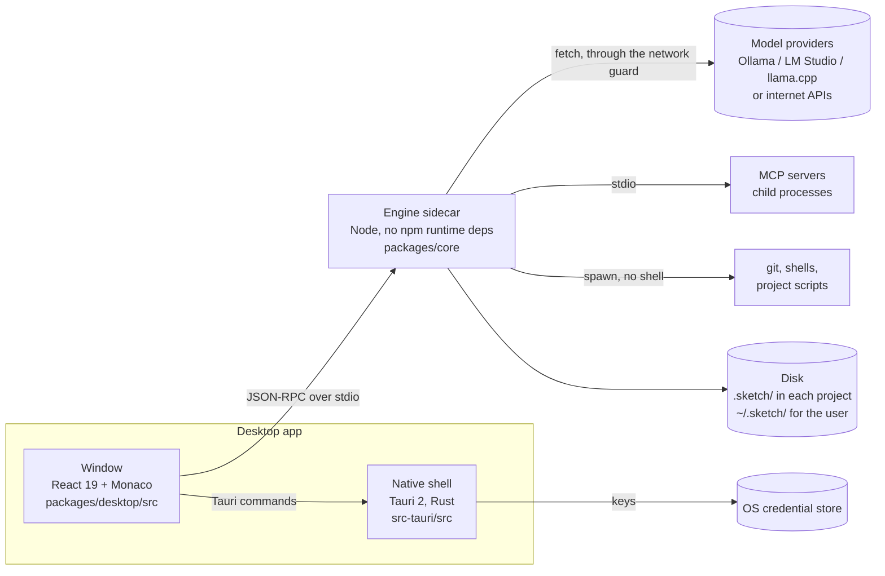

# Sketch architecture

How Sketch is built, as of 2026-11-01. The repository's older `architecture.md` describes the original plan; this page describes the code.

## Processes

- **Window** (`packages/desktop/src`): all UI. State lives in one reducer (`state/AppState.tsx`) and is saved to local storage (`sketch.ui.v1`): conversations, open folders, layout, preferences. It talks to the engine only through the client seam (`lib/client.ts`), with two transports: stdio in the app (`lib/stdioClient.ts`) and HTTP for the Vite dev bridge (`lib/httpClient.ts`).
- **Native shell** (`packages/desktop/src-tauri/src`): the window, contained file commands, the OS credential store (`secret_store.rs`, `os_credentials.rs`), and launching the engine sidecar.
- **Engine** (`packages/core/src`): everything that reasons, edits, runs or reaches a provider. One method table, `rpc/methods.ts` (`METHODS`, 81 methods), serves both transports and the CLI.

## Engine modules

| Module | Job |
|---|---|
| `loop/` | The agent loop (`runTask`), the JSON action protocol, edit application |
| `providers/`, `settings/` | Provider adapters, catalog, connection tests, model lists, ChatGPT sign-in |
| `tools/` | Project read tools, `run_command`, background processes, git, terminal, file operations, find and replace, protected paths |
| `capabilities/` | The one authorisation point, `ToolDispatcher.call` |
| `mcp/` | MCP client and host, curated catalog, the user's own servers |
| `skills/`, `registry/` | `SKILL.md` loading, the skill registry with digests and grants, skill training |
| `context/`, `memory/` | Walker, repository graph, architecture views, hybrid search, embeddings, project memory |
| `verify/` | The nine-stage verification contract and runner, live app check |
| `events/`, `cost/` | Append-only event log, redaction, cost ledger, budgets |
| `strategy/` | Strategies and roles for multi-agent dispatch |
| `privacy/` | Offline Mode and the network guard |
| `local/` | Local model manager (Ollama) and hardware check |

## Storage

There is no database and no server. Data is files:

| Data | Where | Format |
|---|---|---|
| Run events (audit log) | `<project>/.sketch/events/<date>.jsonl` | Append-only JSONL, redacted on write |
| Undo snapshots | `<project>/.sketch/snapshots/` | File copies plus a journal |
| Project memory | `<project>/.sketch/memory/` | Append-only JSONL with supersede records |
| Installed skills and grants | `<project>/.sketch/skills/` | `SKILL.md` folders; `.grants/<name>.json` |
| Project MCP servers | `<project>/.sketch/mcp.json` | `mcpServers` JSON |
| Your MCP servers, approvals | `~/.sketch/mcp.json`, `~/.sketch/mcp-trust.json` | JSON |
| Offline Mode | `~/.sketch/privacy.json` | JSON |
| Provider settings | the provider settings file (key-free) | JSON |
| API keys | OS credential store | - |
| Chats, layout, preferences | window local storage | JSON |

`.sketch/` writes a `.gitignore` containing `*` on first use, so the engine's records never appear in `git status`.

SQLite was considered and not adopted: the append-only guarantees are enforced by construction (a test reads the store's source to prove it writes only with `appendFile`), and the engine has no runtime dependencies.

## Request path, end to end

1. The composer builds a task and run options (`lib/AgentSession.tsx`, `lib/runDefaults.ts`): provider, mode, history, budget, enabled MCP servers.
2. The transport sends `run` to the engine with the key merged in at call time.
3. `run` resolves the provider (refused here when Offline Mode forbids it), loads skills and grants, opens the tool layer (project tools, git tools, commands when allowed, MCP servers), and calls `runTask`.
4. Each model turn is one JSON action. Edits go through the snapshotting writer after containment and protected-path checks; tools go through `ToolDispatcher.call`; commands go through the classifier and, in Agent mode, through the user's approval.
5. Every step is an event, streamed to the window as it is written and kept in the project's log.

## Boundaries that matter

- **Containment:** every write resolves to a real path inside the project; links out are refused (`orchestrator/file-writer.ts`).
- **Protected paths:** `.git/`, Sketch's records, grants and secrets files (`tools/protectedPaths.ts`).
- **No shell:** commands run as argument vectors; pipes, `&&`, redirects and substitutions are refused (`tools/command.ts`).
- **One authorisation point** for tools (`capabilities/guard.ts`).
- **One network gate** for the engine's own requests (`privacy/offline.ts`).

See `docs/SECURITY_MODEL.md` for the threat model.
